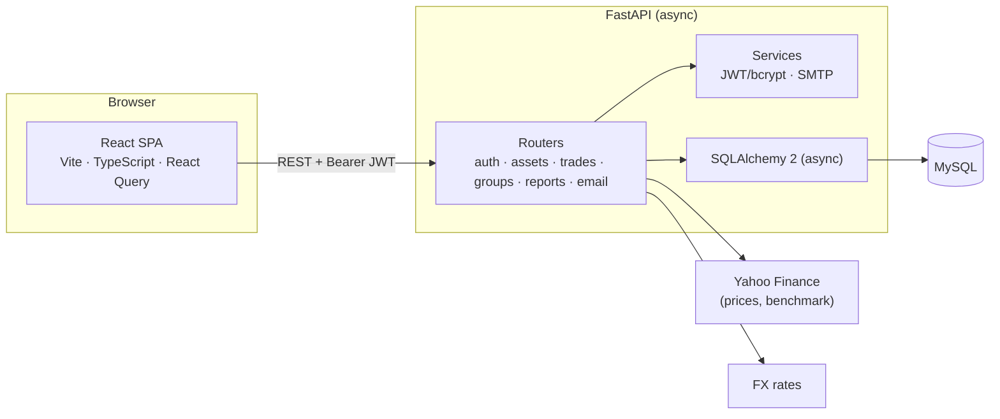

# Portfolio Manager

[](https://github.com/bhanu18/portfolio-manager/actions/workflows/ci.yml)


[](backend/LICENSE)

A multi-currency stock, ETF and crypto portfolio tracker. Record trades, share portfolios with a group,
and see what your holdings are worth today in any currency — with FIFO cost basis and FX-adjusted returns.

<!-- Screenshots: add images to docs/screenshots/ and uncomment


-->

## Features

- **Assets** — stocks, ETFs, crypto and cash; live prices from Yahoo Finance with bulk refresh
- **Trades** — buys and sells in the asset's native currency, scoped to a group
- **Groups** — shared portfolios with per-group roles (admin / member) on top of global user roles
- **Valuation** — current value of any holding converted to a target currency
- **Performance report** — FIFO cost basis, unrealized gain/loss, annualized return, local vs. FX gain,
  breakdowns by currency and asset type, benchmark comparison and alpha
- **Auth** — JWT (OAuth2 password flow), registration, password change and email-based reset,
  rate-limited sensitive endpoints

## Architecture



```
portfolio-manager/
├── backend/          FastAPI, SQLAlchemy (aiomysql), Alembic, pytest
├── frontend/         Vite, React 18, TypeScript, React Query, axios
├── docs/             feature specs (reports, permissions, scoring)
└── .github/workflows CI for both apps
```

## Getting started

### Backend — http://localhost:8000 (interactive docs at `/docs`)

Requires **Python 3.12** and a MySQL database.

```bash
cd backend
uv venv venv --python 3.12 && source venv/bin/activate   # or: python3.12 -m venv venv
uv pip install -r requirements-dev.txt                   # or: pip install -r requirements-dev.txt
cp .env.example .env                                     # set DB URLs, SECRET_KEY, SMTP
alembic upgrade head                                     # migrations are not run on app start
uvicorn main:app --reload
```

> Python 3.14 fails to build `pydantic_core` / `watchfiles` with the pinned versions.

### Frontend — http://localhost:5173

```bash
cd frontend
npm install
cp .env.example .env    # VITE_API_BASE_URL=http://localhost:8000
npm run dev
```

Allowed frontend origins are configured with `CORS_ORIGINS` (comma-separated) in `backend/.env`.

## Quality checks

Everything below runs in GitHub Actions on every push and pull request.

| | Backend (`cd backend`) | Frontend (`cd frontend`) |
|---|---|---|
| Lint | `ruff check .` | `npm run lint` |
| Format | `ruff format .` | `npm run format` |
| Types | `mypy` | `npm run typecheck` |
| Tests | `pytest` (needs `TEST_DATABASE_URL`) | — |
| Build | `docker build -t portfolio-api .` | `npm run build` |

Pre-commit hooks run the linters and formatters before each commit:

```bash
pip install pre-commit && pre-commit install
pre-commit run --all-files
```

Tests run against a real MySQL database: the schema is created with Alembic once per session and every
test runs inside a transaction that is rolled back.

## Docker (backend)

```bash
cd backend
docker build -t portfolio-api .
docker run --env-file .env portfolio-api alembic upgrade head
docker run --env-file .env -p 8000:8000 portfolio-api
```

Health check: `GET /health` (reports database connectivity).

## Tech stack

**Backend:** Python 3.12 · FastAPI · SQLAlchemy 2 (async) · Alembic · Pydantic v2 · MySQL · python-jose ·
passlib/bcrypt · slowapi · yfinance · pandas · pytest · ruff · mypy

**Frontend:** React 18 · TypeScript · Vite · React Router · TanStack Query · axios · ESLint · Prettier

## Research desk

Research US stocks and ETFs, Treasury yields and bills, money-market funds, and bond
issuer risks in **Research**. Ask a question, inspect the dated evidence alongside a
saved analyst brief, and ask follow-ups. Use **Research** on a holding to prefill its
ticker; portfolio balances are never sent to the agent. Sessions are private to their
owner, including when that owner belongs to a shared portfolio group.

The agent supports OpenAI Responses (default `gpt-5-mini`) and Anthropic Messages
(default `claude-sonnet-5-5`) with cited web search,
read-only Yahoo market snapshots, and the official US Treasury XML feeds. Reports
retain inline citations, source URLs, observation dates, retrieval times, units, and
provider warnings. Quotes may be delayed; individual bond pricing, bond accounting,
trading, scheduled monitoring, and shared reports are not included.

### Setup

1. Apply migrations: `cd backend && alembic upgrade head`.
2. Set `OPENAI_API_KEY` and/or `ANTHROPIC_API_KEY` in `backend/.env`. Keys stay on the server. `RESEARCH_MODEL`
   can select another Responses model supporting web search and function tools.
3. Start the API normally, then start a **separate process** from `backend/`:

   ```bash
   source venv/bin/activate
   python -m service.research.worker
   ```

The API only queues work. At least one worker must run against the same database and
configuration as the API. Multiple workers use row locks and skip locked jobs to claim
work atomically (MySQL 8+). Navigation or refresh does not stop a job. Workers renew
30-second leases every 10 seconds. Shutdown, expired leases, missing workers, and the
three-minute run deadline produce retryable failures; partial evidence remains saved.
Cancellation stops future work and cancels an in-flight HTTP request when observed by
the heartbeat; a provider request already accepted may still incur charges.

Without a key, saved sessions remain readable and the composer shows a setup message.
The frontend polls active sessions every two seconds. The API exposes owner-scoped
`/research/sessions`, `/research/sessions/{id}/messages`, `/research/runs/{id}`, and
`/research/runs/{id}/cancel`; interactive schemas are available at `/docs`.

### Limits and validation

All research settings are documented in `backend/.env.example`. Defaults are one
active run per user, 20 starts per UTC day, six model turns, eight total tool calls,
24,000 input tokens and 12,000 output tokens per run. Input is conservatively bounded
by UTF-8 byte count before each model call; old conversation context is trimmed.
Usage totals include reasoning tokens reported by the provider. Cancelled and failed
starts count toward the daily limit, and deleting a session does not reset it.
These are request/token limits, not an exact dollar spending cap; configure provider
billing controls as appropriate. No provider retries happen automatically.

Run `pytest tests/test_research_agent.py` for offline provider/agent checks and
`pytest tests/test_research_api.py` with the disposable `TEST_DATABASE_URL` for API,
queue, migration round-trip, and isolation checks. Run `npm run test:research` in
`frontend/` for citation, comparison-table, and HTML-safety rendering checks. CI never
needs a paid provider key. For a live smoke test after
setup, research Apple, compare SPY/VTI, compare Treasury bills with money-market funds,
ask a follow-up, reload an active session, and verify its citations and observation dates.

### Research provider selection

Choose OpenAI or Anthropic in the research composer, including for follow-up questions.
Set `ANTHROPIC_API_KEY` to enable Claude and optionally change
`ANTHROPIC_RESEARCH_MODEL=claude-sonnet-5-5`. `RESEARCH_MODEL` controls OpenAI.
`RESEARCH_PROVIDER=openai` sets the default; if only one provider is configured it
is selected automatically. Unconfigured providers are disabled in the selector.

Run `alembic upgrade head` from `backend` and restart both the API and research
worker after configuration changes. Both processes need the selected provider's key.
Each queued run saves its provider and model; configuration changes do not switch an
existing run. Existing reports retain OpenAI as their provider. Provider errors never
silently switch to another provider. Claude uses its basic web-search tool plus the
same read-only stock and Treasury tools, with the same run limits and private storage.

### Investment decision research

Stock/ETF research now includes a read-only `investment_analysis` tool, shared by
OpenAI and Anthropic. It calculates SMA50/SMA200, 20-session MA changes, distance
from each average, and the latest crossover. Three fixed strategies are compared:
buy-and-hold, price above SMA200, and SMA50 above SMA200. The report shows sampled
price/equity/drawdown charts and full-resolution return, annualized return, maximum
drawdown, volatility, one-way trade count, and exposure metrics.

The engine requests up to ten years of evaluation history plus 200 warm-up observations.
Signals execute at the following session's close. Fees plus slippage are 10 basis points
per entry/exit, cash earns zero, and adjusted prices approximate dividend reinvestment.
Open positions are marked to market, without a forced exit. No taxes or market impact
are modeled. Earlier 70% and recent 30% evaluations appear when each has at least 252
observations; rules are never optimized, and these are not independently unseen tests.
Insufficient/invalid data is unavailable; stale, gapped, and short history is flagged.
These are historical simulations on selected tickers, not forecasts.

Both models read the same editable instructions from
`backend/service/research/prompt.md`. Restart research workers after editing.
The prompt requests valuation with verified reporting dates and a bull/base/bear
scenario table, using a disclosed 12-month horizon unless the user supplies one.
Unsourced price targets or probabilities are prohibited; qualitative scenarios are
used when numerical assumptions cannot be substantiated. Current Yahoo fundamentals
must not be used as historical backtest inputs.

Chart data persists within existing research evidence JSON; no new migration is
needed for this analysis upgrade. Existing reports remain readable; start a new turn
to request the expanded analysis.
